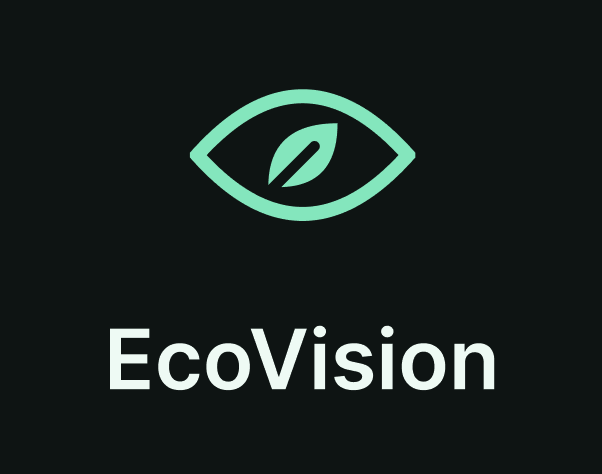
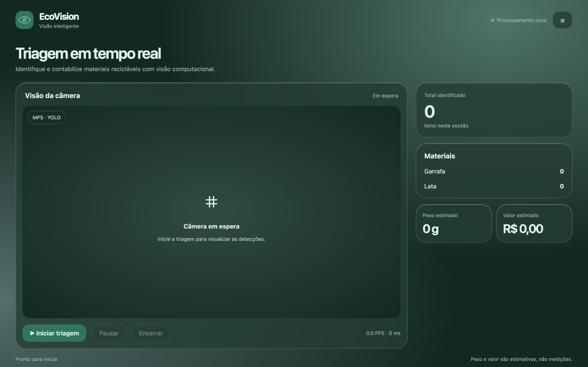
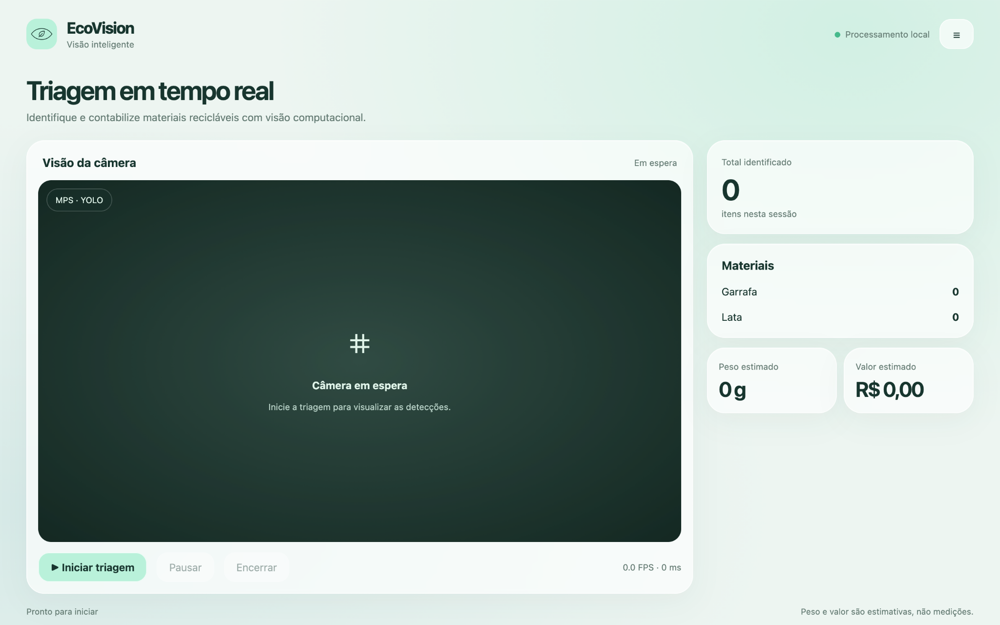
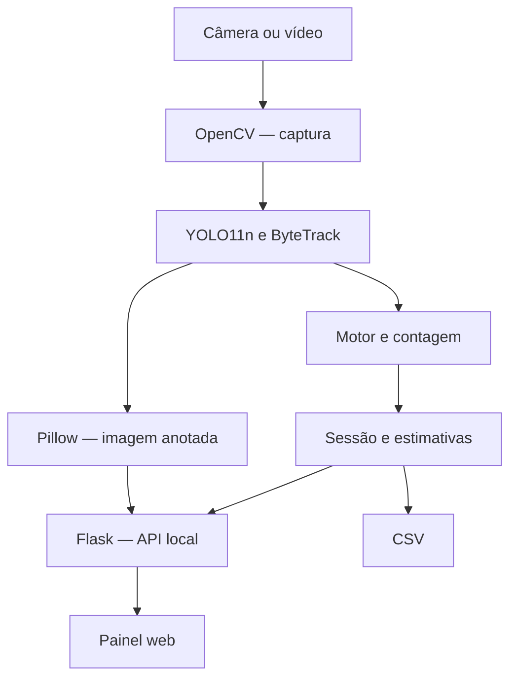
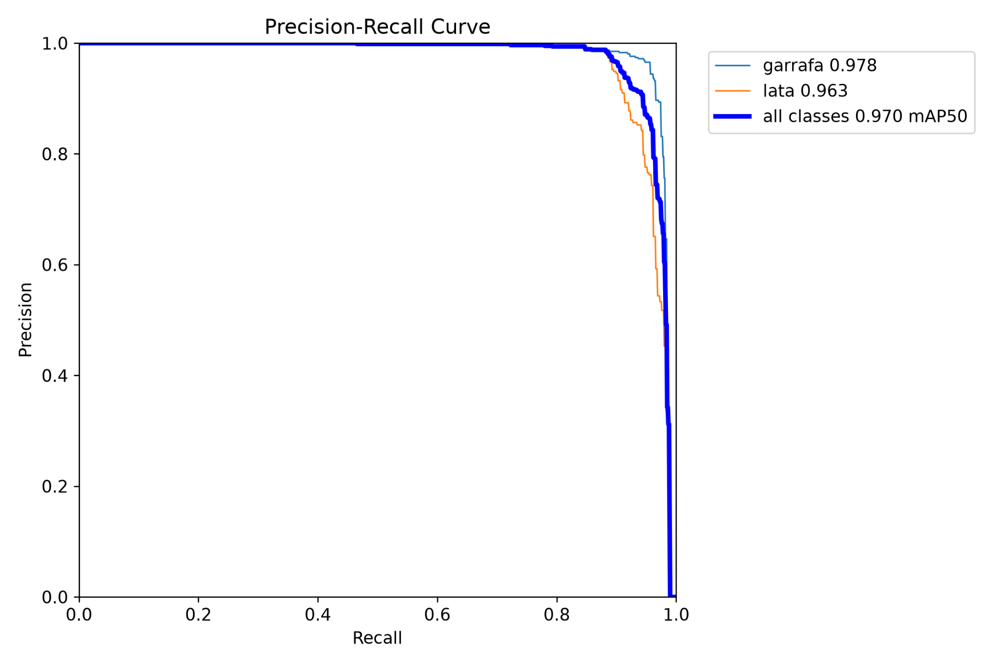

<p align="center">
  
</p>

<h1 align="center">EcoVision</h1>
<p align="center">Reconhecimento e contagem de materiais recicláveis em tempo real.</p>

A EcoVision é uma aplicação acadêmica de visão computacional que identifica garrafas e latas, acompanha objetos entre quadros e registra a contagem por material. O processamento é local e a interface apresenta estimativas de massa e valor, calculadas a partir de coeficientes configuráveis.

Desenvolvido na disciplina de Programação em Python do curso de Engenharia de Software da Faculdade Anchieta de Jundiaí, sob orientação do professor Daniel Feitoza Ruis da Silva (2026).

## Interface

**Tema escuro**



**Tema claro**



## Funcionalidades

- Detecção de garrafas e latas com YOLO11n e rastreamento com ByteTrack.
- Contagem por categoria e total da sessão, com deduplicação por trilhas.
- Captura por câmera ou arquivo de vídeo, pausa, retomada e encerramento.
- Estimativas de massa e valor, histórico e exportação em CSV.
- Interface web local com temas claro e escuro, abertura animada e modo apresentação em tela cheia.
- Interface desktop anterior disponível em `main.py`.

## Tecnologias

Python, Ultralytics YOLO, PyTorch, OpenCV, NumPy, Pillow, Flask, Werkzeug, Jinja2, PyYAML e lapx. O frontend utiliza HTML, CSS, JavaScript e SVG, sem framework ou etapa de compilação. A interface desktop utiliza CustomTkinter/Tkinter.

## Instalação

Obtenha os arquivos do projeto e execute os comandos abaixo na raiz. Utilize uma versão de Python compatível com as dependências; o ambiente de desenvolvimento registrado usa Python 3.13.15 e os manifestos também indicam 3.10–3.12. Para o desktop, Tkinter/Tk deve estar disponível.

### macOS

```bash
python3 -m venv .venv
.venv/bin/python -m pip install -r requirements-modern.txt
.venv/bin/python main_modern.py
```

### Windows (PowerShell)

```powershell
py -m venv .venv
.\.venv\Scripts\python.exe -m pip install -r requirements-modern.txt
.\.venv\Scripts\python.exe main_modern.py
```

O servidor é executado localmente e abre o navegador. A opção `--no-browser` imprime o endereço para acesso manual. No macOS, permita o acesso à câmera ao Terminal ou à IDE. A execução completa em Windows ainda precisa ser validada.

### Pesos e configuração

O checkpoint de duas classes usado no projeto deve estar em `models/reciclagem_best.pt`. O `.gitignore` atual exclui pesos em `models/*.pt`; caso não sejam distribuídos com o repositório, obtenha o arquivo com os autores. A publicação dos pesos e dados depende da revisão de licenças. Não é necessário treinar novamente para executar a aplicação com o checkpoint disponível.

Os padrões ficam em `config/settings.yaml`; configurações específicas da máquina ficam em `config/settings.local.yaml` e têm prioridade. Ajuste o índice da câmera pelo menu ou com o auxílio de `python tools/list_cameras.py --show`. A configuração utilizada na demonstração solicita 1280 × 720 e usa confiança 0,75, IoU 0,50 e dispositivo `auto`. Sem o arquivo local, os padrões podem diferir (confiança 0,40, câmera 1). O dispositivo automático tenta MPS, CUDA e CPU conforme disponibilidade. A ausência do checkpoint especializado pode acionar o modelo genérico COCO em modo demo; este não equivale ao detector treinado de duas classes.

## Uso

1. Pressione Enter ou Espaço para iniciar a abertura animada.
2. Aguarde o carregamento do modelo e clique em **Iniciar triagem**.
3. Acompanhe caixas, classes, contadores e indicadores de sessão.
4. Encerre a captura e exporte os resultados pelo menu.

| Atalho | Função |
| --- | --- |
| `P` | Modo apresentação em tela cheia |
| `Esc` | Sair da tela cheia ou fechar o menu |
| `0` | Classificação automática (padrão) |
| `1` / `2` | Forçar a classe garrafa / lata para testes controlados |

**Modo manual:** altera a classe efetiva de detecções reais após a inferência e o rastreamento, sem gerar caixas artificiais nem alterar os pesos. Eventos já contabilizados preservam a classe registrada. A confiança da classe substituída não é informada como confiança da IA. A interface não sinaliza permanentemente o modo manual; identifique seu uso em gravações e relatórios. Avaliações do modelo devem ocorrer no modo automático.

## Arquitetura



A captura e a inferência usam threads separadas. O navegador consulta estado e quadros por HTTP local. Os endpoints principais são `GET /api/state`, `GET /api/frame`, `POST /api/action` e `GET /api/export`.

| Caminho | Responsabilidade |
| --- | --- |
| `main_modern.py` / `main.py` | Entradas web e desktop |
| `recicla/core/` | Captura, inferência, contagem, sessões |
| `recicla/web/` / `recicla/ui/` | Interfaces web e desktop |
| `config/` | Configurações, materiais e tracker |
| `models/` | Pesos e metadados |
| `training/` | Preparação, treino, avaliação e exportação |
| `tools/` / `tests/` | Utilitários e verificações |

## Modelo e resultados

O checkpoint ativo é um YOLO11n ajustado para duas classes (`garrafa`, `lata`), treinado durante 150 épocas, com imagens de 640 px e lote 8. As métricas registradas para os pesos ativos (época 140, validação) são:

| Precisão | Recall | mAP@50 | mAP@50–95 |
| ---: | ---: | ---: | ---: |
| 97,69% | 91,65% | 97,04% | 81,31% |



A curva enviada separadamente pelo grupo indica AP@50 de 0,978 para garrafa e 0,963 para lata. Sua origem exata não foi comprovada por um manifesto de execução. Métricas de validação não são garantia de desempenho em webcam ou de contagem correta. O manifesto exato do dataset final de duas classes e uma avaliação independente não estão disponíveis. O pipeline local de preparação documenta TACO e Drinking Waste Classification; seus dados e receita de sete classes não devem ser confundidos com o treino final.

## Testes e limitações

Para executar os testes automatizados, instale `pytest` no ambiente virtual. Uma verificação selecionada em Linux (`tests/test_counting.py`, `tests/test_session_config.py`, `tests/test_prepare_dataset.py`) obteve 15 testes aprovados e 5 falhas relacionadas ao catálogo antigo de sete classes. A atualização dessas fixtures e da receita de dados permanece pendente.

- Oclusões, mudanças de ID e objetos muito semelhantes podem gerar recontagens ou omissões.
- Peso e valor são estimativas configuráveis, não medições reais.
- A reprodução do treino final exige uma receita e um dataset compatíveis com as duas classes.
- A compatibilidade e o desempenho em diferentes plataformas exigem validação adicional.

## Equipe

André Czank de Souza · Enzo Dias Ienne · Enzo Sodré · Gabriel Tobias M. B. Rocha · Giovanne Soares Sorelli · Victor Hugo Dorassi Mingotii · Vinicius de Matos Guerra.

## Licenciamento

A licença do projeto e as condições de redistribuição das dependências, pesos e imagens devem ser verificadas pelos autores antes de uma publicação pública. Não há licença nova atribuída por este README.
