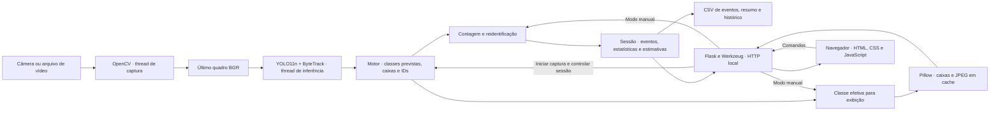

# Levantamento técnico da EcoVision

A EcoVision é uma aplicação local de visão computacional para detectar, rastrear e contabilizar objetos recicláveis em imagens de uma câmera ou de um arquivo de vídeo. A aplicação estima massa e valor com coeficientes configuráveis por categoria. O ponto de entrada da interface web é `main_modern.py`. A interface desktop anterior permanece disponível em `main.py`.

O levantamento se baseia no código e nos artefatos da pasta principal. As versões foram lidas do ambiente `.venv`. Os checkpoints foram inspecionados em modo de leitura, sem executar treinamento ou avaliação, e os arquivos de imagens e rótulos foram contados no disco. Os valores de desempenho apresentados são métricas registradas pelos treinos. Câmera física, apresentação em navegador e execução em Windows não foram revalidadas nesta análise.

## 1. Tecnologias

### Linguagens e formatos

- **Python** implementa o servidor, a captura, a inferência, o rastreamento, as sessões, a interface desktop, as ferramentas, o treinamento e os testes.
- **HTML, CSS e JavaScript** implementam o painel web, sem framework JavaScript ou etapa de compilação. **SVG** define a marca, o favicon e os elementos vetoriais da abertura.
- **YAML** armazena configurações, taxonomia, receita de datasets e parâmetros do tracker. **JSON** é usado na API e em relatórios e metadados. **CSV** armazena eventos, resumos de sessões e a série de métricas de treinamento.
- O painel usa APIs nativas do navegador, incluindo Fetch, Blob, URL de objetos, Fullscreen API, Web Animations API, `requestAnimationFrame`, diálogos HTML e `prefers-reduced-motion`.

### Ambiente registrado e responsabilidades

Os números são as versões instaladas na `.venv` local, com Python **3.13.15**. Os arquivos de requisitos declaram faixas ou mínimos, portanto uma instalação nova pode resolver versões diferentes.

| Componente | Versão instalada | Uso no projeto |
| --- | --- | --- |
| Ultralytics | 8.4.211 | Carregamento de checkpoints YOLO, inferência, integração com ByteTrack, treinamento, validação e exportação opcional |
| PyTorch (`torch`) | 2.15.0 | Execução do modelo, tensores e seleção de CPU, Apple MPS ou CUDA |
| Torchvision | 0.29.2 | Dependência da pilha de visão do Ultralytics, sem importação direta no núcleo |
| OpenCV (`opencv-python`) | 5.0.0.93 | Captura e leitura de vídeo, espelhamento, conversão BGR para RGB e ferramentas de câmera |
| NumPy | 2.5.4 | Matrizes de pixels e conversão de saídas da IA em dados usados pelo motor |
| lapx | 0.13.1 | Dependência de associação de detecções do tracker no Ultralytics |
| Pillow | 13.0.0 | Desenho de caixas e rótulos, JPEG no servidor e integração de imagens com Tk no desktop |
| Flask | 3.1.3 | Rotas HTTP, respostas JSON, página e arquivos estáticos |
| Werkzeug | 3.1.9 | Servidor WSGI local com atendimento em threads |
| Jinja2 | 3.1.6 | Renderização do template HTML, inclusive inserção do SVG da abertura |
| MarkupSafe | 3.0.4 | Marcação do SVG local como conteúdo confiável para inclusão inline |
| PyYAML | 6.0.3 | Leitura e escrita de configurações e especificações de dataset |
| CustomTkinter | 6.0.0 | Componentes da interface desktop anterior sobre Tkinter |
| Matplotlib | 3.11.2 | Dependência da pilha do Ultralytics para gráficos de treinamento e validação |

A biblioteca padrão fornece `threading` e `queue` para concorrência, `dataclasses` para estruturas de dados, `pathlib` para caminhos, `csv` e `json` para serialização, `logging` para diagnósticos, e `argparse` e `webbrowser` para os pontos de entrada. O código menciona pytest para testes, porém o pacote não consta na `.venv` consultada. Dependências no código de terceiros de `datasets/raw/taco/` não integram a aplicação.

## 2. Arquitetura

### Estrutura e módulos

| Caminho | Responsabilidade |
| --- | --- |
| `main_modern.py` | Executa a aplicação web. `--no-browser` deixa a abertura da URL a cargo do operador |
| `main.py` | Inicia a interface desktop anterior |
| `recicla/web/server.py` | Configura Flask, inicializa o modelo, atende à API, processa comandos e gera JPEGs |
| `recicla/web/index.html` e `static/` | Estrutura do painel, estilos, animações, marca provisória, atalhos e cliente HTTP |
| `recicla/core/camera.py` | Captura OpenCV em thread, publicação do quadro mais recente, reprodução em loop e reconexão |
| `recicla/core/detector.py` | Seleção do dispositivo, carregamento, aquecimento, inferência e tradução de classes para materiais |
| `recicla/core/engine.py` | Coordena captura e inferência, mantém o resultado atual e controla transições e substituição de classe |
| `recicla/core/counting.py` | Confirma trilhas, acumula votos de classe e deduplica contagens por ID e reidentificação espacial |
| `recicla/core/types.py` | Contratos de dados para trilhas, detecções, eventos de contagem e quadros processados |
| `recicla/core/session.py` e `estimates.py` | Eventos, agregados, taxas, estimativas, exportação CSV e histórico de sessões |
| `recicla/ui/` | Desktop CustomTkinter, componentes, configurações e rotinas de desenho compartilhadas com a web |
| `recicla/config.py`, `recicla/paths.py` e `config/` | Configuração tipada, resolução de caminhos, catálogo de materiais e ajustes do ByteTrack |
| `models/` e `yolo11n.pt` | Checkpoints da aplicação, metadados e modelo genérico de contingência |
| `datasets/`, `training/` e `runs/` | Fontes e amostras preparadas, scripts de preparação/treino/avaliação/exportação e artefatos de uma execução local |
| `tools/` | Listagem de câmeras, captura de fotos para dataset, teste direto com webcam e benchmark de inferência |
| `sessions/` | Arquivos CSV de eventos e resumos, além do histórico agregado |
| `tests/`, `legacy/`, `backups/` e `entregas/` | Testes, protótipos anteriores, cópias de segurança e arquivos para distribuição |

### Fluxo de execução

1. O servidor local inicia em `127.0.0.1`, em uma porta dinâmica. Uma thread carrega o checkpoint e aquece o pipeline com uma matriz preta. A abertura do navegador é opcional. A tela inicial consulta o estado real da preparação.
2. Ao iniciar a triagem, o servidor processa o comando na thread principal para abrir a fonte. No macOS, uma câmera por índice tenta primeiro AVFoundation e, se necessário, a seleção padrão do OpenCV. Um arquivo é resolvido em relação à raiz quando o caminho é relativo e volta ao começo ao chegar ao fim.
3. A thread de captura publica o último quadro BGR e seu número sequencial. Quadros antigos podem ser descartados quando a inferência é mais lenta. A resolução e a taxa da câmera são solicitadas ao driver e podem ser negociadas pelo dispositivo.
4. A thread de inferência consome um quadro novo e executa `model.track(..., persist=True)`. Cada saída válida contém as coordenadas `xyxy`, confiança, material mapeado, e ID do ByteTrack quando disponível. Classes fora do catálogo são descartadas. O motor publica o quadro e a medição de tempo de inferência.
5. O gerenciador de contagem decide se a trilha confirma um objeto novo. A sessão recebe um evento com a categoria efetiva e agrega as estatísticas. O motor publica as detecções exibíveis, com o modo manual aplicado quando ativo.
6. O Flask usa Pillow para desenhar caixas, cores, rótulos e IDs sobre a imagem RGB. Mantém em cache o JPEG de qualidade 82 por resultado. O navegador solicita o estado a cada **350 ms** e tenta buscar imagem a cada **65 ms** durante a execução, com uma requisição de quadro por vez. Em pausa, mantém a imagem e pode atualizá-la se mudar o modo de classificação. O elemento `img` usa `object-fit: contain`.

O transporte é HTTP local com polling independente para estado e imagem. O navegador recebe imagens anotadas completas, enquanto históricos e agregados vêm em JSON. Os comandos de câmera e sessão passam por uma fila de até 32 entradas, e a substituição de classe é aplicada de forma síncrona sob locks. A sessão mantém os agregados em memória e exporta arquivos quando solicitado. As duas interfaces reutilizam o núcleo, e cada execução cria sua própria sessão.



### Rotas web

| Método e caminho | Função e retorno |
| --- | --- |
| `GET /` | Entrega o painel HTML por Jinja e inclui o SVG da abertura |
| `GET /static/<arquivo>` | Entrega CSS, JavaScript e os demais recursos estáticos |
| `GET /ecovision.svg` | Entrega o SVG da raiz, quando disponível, ou a marca provisória |
| `GET /api/state` | JSON com estado do motor, preparação inicial, mensagens, erros, modelo, dispositivo, configurações, materiais, modo manual, FPS, tempo, agregados e até 50 eventos recentes |
| `GET /api/frame` | Último JPEG anotado, com `Cache-Control: no-store`. Retorna `204` se ainda não houver resultado |
| `POST /api/action` | Recebe JSON. `start`, `pause`, `resume`, `stop`, `reset`, `new` e `settings` entram na fila (`202`). `class_override` retorna `200` após aplicar o modo. Dados inválidos retornam `400`. Carregamento inicial ou fila cheia podem retornar `503` |
| `GET /api/export` | Grava CSV de eventos e de resumo no disco e devolve o resumo para download. Sem eventos contabilizados, retorna `400` |

O corpo da ação contém `action`. Para `settings`, os campos adicionais são `source`, `path` e `conf` (de 0,01 a 0,99). A alteração efetiva requer o motor em espera. O aceite `202` informa que a ação entrou na fila. Para `class_override`, o campo `material` recebe `null`, `"garrafa"` ou `"lata"`, condicionado à presença da categoria no catálogo.

### Rastreamento e contagem

- ByteTrack preserva IDs entre inferências. O motor reinicia o estado do tracker ao iniciar outra captura com o modelo já carregado. A pausa conserva a câmera aberta e suspende o consumo de novos quadros pela inferência.
- Uma detecção sem ID pode ser exibida, mas fica fora da contagem. Cada ID acumula observações. Ao atingir `min_hits`, a classe automática é a de maior soma de confiança até então. O evento automático guarda a confiança média da trilha. O código acumula hits enquanto o estado existir, sem exigir quadros adjacentes.
- Quando um ID novo confirma, o reconciliador procura um ID contado que não esteja no quadro atual, tenha sido visto dentro da janela, possua a mesma classe votada e tenha sobreposição de caixas igual ou superior ao limiar. Se houver correspondência, o novo ID é tratado como continuação. A reidentificação usa classe e IoU, sem descritor visual.
- A sessão soma quantidade por categoria. A massa em quilogramas é a contagem multiplicada pelo peso médio em gramas dividido por mil. O valor multiplica a massa pelo preço por quilograma. O relógio da sessão, a taxa média e a contagem nos últimos 60 segundos são calculados pelo núcleo. O catálogo efetivo usa 35 g e R$ 2,25/kg para garrafa e 14 g e R$ 6,00/kg para lata. São valores de exemplo.

## 3. Inteligência artificial

### Modelo em uso e configuração efetiva

A aplicação carrega `models/reciclagem_best.pt`, definido em `config/settings.local.yaml`. O SHA-256 é `3cb5726f454980d7b1e543986a1ef5016077c920ecf134101599dcd09a5dfb11`. O arquivo `models/reciclagem_best.meta.json` identifica o checkpoint de origem como um `best.pt` importado de outra pasta e registra a exportação em 24/11/2026. O arquivo usado pela aplicação é distinto de ambos os checkpoints em `runs/detect/reciclagem/weights/`.

O checkpoint ativo é um **YOLO11n** (`yolo11n.yaml`, escala `n`), para detecção de objetos com caixas. O modelo serializado tem **2.605.126 parâmetros**, 24 módulos de primeiro nível na sequência computacional e cabeça `Detect` com strides 8, 16 e 32. O backbone inclui blocos `Conv`, `C3k2`, `SPPF` e `C2PSA`. A cabeça agrega mapas de escalas diferentes por upsampling e concatenação. Os IDs de saída são **0 = garrafa** e **1 = lata**. O checkpoint registra a versão Ultralytics **8.4.218**, enquanto o ambiente de execução consultado possui **8.4.211**.

| Parâmetro | Valor efetivo |
| --- | --- |
| Fonte da câmera | Índice 0, espelhamento habilitado |
| Captura solicitada | 1280 × 720 a 60 FPS, com até cinco tentativas de reconexão |
| Inferência | `imgsz=640`, `conf=0.75`, `iou=0.50`, `max_det=50` |
| Dispositivo e precisão | `device=auto`, `half=false` |
| Limite de inferência | 30 FPS, sem garantia de desempenho sustentado |
| ByteTrack | `track_high_thresh=0.25`, `track_low_thresh=0.10`, `new_track_thresh=0.25`, `track_buffer=60`, `match_thresh=0.8`, `fuse_score=true` |
| Confirmação e reidentificação | 5 observações por trilha, janela de 3 s e IoU mínimo de 0,40 |

Os critérios de confiança do detector atuam antes da associação. O IoU de inferência configura a supressão de caixas do detector. O IoU de 0,40 é aplicado separadamente pelo contador. O tracker real da aplicação é selecionado por `config/bytetrack_recycle.yaml`, independentemente do campo `tracker` salvo nos argumentos de treinamento.

Se o caminho do modelo treinado não existir, a aplicação usa `yolo11n.pt` na raiz nesta configuração. O checkpoint genérico tem 80 classes COCO, mas o catálogo ativo só associa `bottle` a garrafa e `cup` a lata nesse caso. O painel sinaliza **MODELO DEMO · COCO**. Esse fallback não é acionado para qualquer erro de leitura de um checkpoint que existe.

### Fontes de dados e preparação

A pasta disponível em `datasets/reciclagem/` tem **sete classes**. Suas contagens foram conferidas com `data.yaml`, `report.json` e os arquivos de imagem e rótulo. O checkpoint ativo aponta para um `data.yaml` de mesmo nome em um ambiente com caminhos Windows, mas os arquivos locais não demonstram que seja a mesma revisão. A composição, a separação das amostras e o número de imagens do treino ativo de duas classes **não foram confirmados**.

- **TACO** (`datasets/raw/taco/data/`), anotações COCO de lixo em contexto. O JSON local registra 1.500 imagens, 4.784 anotações e 60 categorias. Esses números referem-se às entradas do JSON, antes da filtragem. A documentação local atribui CC BY 4.0 às anotações.
- **Drinking Waste Classification** (`datasets/raw/drinking-waste/Images_of_Waste/`), com imagens em `rawimgs/` e uma organização anotada no formato YOLO em `YOLO_imgs/`. A receita mapeia classes de garrafas plásticas e latas e omite garrafas de vidro. A licença exata das imagens dessa cópia não foi confirmada.
- **ZeroWaste-f** e **dataset próprio** aparecem como fontes opcionais desativadas em `training/datasets.yaml`. A distribuição local conferida é composta por arquivos prefixados por `taco_` e `drinking_waste_`.

O script `training/prepare_dataset.py` lê COCO ou YOLO, normaliza nomes, mapeia categorias para os IDs do catálogo, converte caixas COCO para coordenadas normalizadas de centro e dimensões e pode reduzir polígonos YOLO a suas caixas envolventes. Ele ignora anotações COCO `iscrowd`, classes sem mapeamento e caixas abaixo de **0,0005** da área da imagem. Retém imagens com pelo menos uma anotação válida. Embaralha imagens com semente 42, destina 15% à validação e 10% ao teste (com truncamento dos tamanhos) e usa o restante para treino. Copia os arquivos por padrão, com opção de links simbólicos, e grava `data.yaml`, `report.json` e os rótulos `classe cx cy largura altura`. A divisão é por imagem, sem estratificação por classe nem agrupamento por origem ou sequência.

| Conjunto local de sete classes | TACO | Drinking Waste | Imagens | Instâncias anotadas |
| --- | ---: | ---: | ---: | ---: |
| Treino | 719 | 2.846 | 3.565 | 4.272 |
| Validação | 151 | 561 | 712 | 842 |
| Teste | 96 | 379 | 475 | 603 |
| Total | 966 | 3.786 | 4.752 | 5.717 |

| Classe do dataset local | Treino | Validação | Teste |
| --- | ---: | ---: | ---: |
| `garrafa_pet` | 1.331 | 260 | 181 |
| `garrafa_plastica` | 891 | 172 | 114 |
| `lata_aluminio` | 1.223 | 237 | 157 |
| `lata_aco` | 22 | 5 | 7 |
| `caixa_papelao` | 113 | 24 | 19 |
| `papel` | 100 | 18 | 9 |
| `embalagem_plastica` | 592 | 126 | 116 |

### Treinamento e métricas registradas

| Evidência | Classes | Épocas configuradas / registradas | Configuração principal |
| --- | ---: | --- | --- |
| Checkpoint ativo `models/reciclagem_best.pt` | 2 | 150 / 150 | YOLO11n pré-treinado, 640 px, lote 8, 4 workers, AdamW, LR inicial 0,001667, paciência 30, semente 42, AMP habilitado na configuração, validação `val`, `device=0` e caminhos de Windows |
| Checkpoint alternativo `models/reciclagem_best_7classes.pt` | 7 | 50 / 50 | Ultralytics 8.4.214, YOLO11n pré-treinado, 640 px, lote 16, 4 workers, AdamW, LR inicial 0,000909, validação `val` e `device=0` |
| Execução local `runs/detect/reciclagem/` | 7 | 30 / 2 | Ultralytics 8.4.211, YOLO11n pré-treinado, 640 px, lote 16 e MPS registrado. O YAML registra `optimizer=auto` e 4 workers. O checkpoint registra AdamW e 0 workers |

O checkpoint ativo também registra weight decay de 0,0005, aquecimento de 3 épocas, `fraction=1.0`, execução determinística configurada e cache desativado. Entre as ampliações registradas estão rotação de até 15 graus, escala 0,5, translação 0,1, inversão horizontal com probabilidade 0,5, vertical com 0,2, HSV (0,015 / 0,6 / 0,4) e mosaic 1,0, com desativação nas últimas 10 épocas. O modelo exato da GPU, a duração de ponta a ponta e o manifesto de dados do treino ativo não foram confirmados. O treino local registra somente duas épocas. A causa do término não está documentada nos artefatos consultados.

| Artefato, origem e época | Precisão | Recall | mAP@0,50 | mAP@0,50:0,95 |
| --- | ---: | ---: | ---: | ---: |
| **Pesos ativos de duas classes**, `train_metrics` e linha correspondente de `train_results`, época 140 | **0,97685** | **0,91647** | **0,97041** | **0,81307** |
| Mesmo treino de duas classes, última linha de `train_results`, época 150 | 0,96589 | 0,91745 | 0,97032 | 0,81233 |
| Pesos alternativos de sete classes, `train_metrics`, época 50 | 0,64720 | 0,63586 | 0,62891 | 0,50522 |
| Execução local de sete classes, `results.csv`, época 1 | 0,81935 | 0,36257 | 0,40096 | 0,20250 |
| Execução local de sete classes, `results.csv`, época 2 | 0,63921 | 0,33519 | 0,36575 | 0,24088 |

Os valores são proporções e dizem respeito às caixas no conjunto de **validação**. Precisão e recall caracterizam a detecção no protocolo do Ultralytics. O mAP@0,50 usa IoU 0,50 e mAP@0,50:0,95 resume múltiplos limiares de IoU. As métricas não quantificam precisão em webcam, identificação de trilhas ou erro de contagem. Não foi localizado relatório de teste independente ou relatório numérico por classe para o modelo ativo. As curvas e matrizes PNG em `runs/detect/reciclagem/` pertencem à execução local de sete classes.

`training/train.py` oferece treino por transferência, opções de dispositivo e retomada, com padrão de 100 épocas no código. `training/evaluate.py` permite avaliar `val` ou `test` e gravar métricas globais e por classe. O padrão do avaliador aponta para o `best.pt` da execução local, portanto uma avaliação do modelo ativo requer os pesos de duas classes e um dataset compatível. `training/export_model.py` valida o mapeamento das classes e copia os pesos com metadados, com opção Core ML experimental. O caminho ativo da aplicação usa PyTorch e `.pt`.

## 4. Funcionalidades

### Interface web

- Painel responsivo com visualização de vídeo, caixas de detecção, IDs, classes, confiança quando aplicável, estado da captura, FPS e tempo de inferência. Exibe total, distribuição por material, massa e valor estimados.
- Controles de início, pausa, retomada e encerramento. A janela de configurações oferece índice de câmera ou caminho de vídeo, caminho do modelo e limiar de confiança. Os valores são persistidos em `settings.local.yaml` quando aplicados.
- Menu hambúrguer com apresentação, configurações, histórico recente, nova sessão, reset com confirmação, exportação e alternância entre tema claro e escuro. O tema é mantido apenas durante a página atual.
- Histórico com até 50 eventos recentes, hora, material e confiança disponível. Nova sessão arquiva os dados da sessão existente quando houver contagem. Reset limpa contagens e estados do contador. A exportação grava CSV de eventos e resumo e entrega o resumo ao navegador. No encerramento normal do servidor, o histórico agregado é atualizado se houver dados.
- Visual com cartões translúcidos, desfoque de fundo, gradientes e espaçamento responsivo. O símbolo do olho com folha também funciona como favicon. A árvore analisada não inclui `ecovision.svg` na raiz, então a rota e a abertura usam `static/provisional-logo.svg`.
- Tela inicial acionada por botão ou teclado. Após 600 ms, desenha o olho, revela a folha, varre o interior do símbolo com um feixe recortado por SVG e apresenta a marca. A sequência nominal dura 2.800 ms, seguida de uma transição de saída de 480 ms. O painel só se libera automaticamente após o fim da animação e a preparação do modelo. Em caso de erro, a abertura informa a falha e oferece acesso ao painel. Há suporte à preferência de movimento reduzido.
- Ao aumentar a contagem real, os valores inteiros animam e o cartão recebe um pulso mint. Os dígitos são tabulares. Menu, temas e notificações têm transições próprias.
- A apresentação usa a Fullscreen API para mostrar o painel completo, inclusive menu e controles. Pode ser acionada antes da animação inicial. O cursor é ocultado após 3 s de inatividade em tela cheia e reaparece com movimento ou tecla. A saída por Esc ou pelo navegador restaura o modo janela. O vídeo mantém a proporção, e as transições de tela cheia são independentes da sessão de triagem.

| Atalho web | Efeito |
| --- | --- |
| **Enter** ou **Espaço** | Aciona a abertura enquanto ela aguarda início |
| **P** | Solicita tela cheia, inclusive durante a espera inicial |
| **Esc** | Sai da tela cheia ou fecha o menu, conforme o estado. Diálogos também têm comportamento nativo de fechamento |
| **0** | Restaura a classificação automática |
| **1** | Aplica a categoria garrafa às detecções válidas |
| **2** | Aplica a categoria lata às detecções válidas |

### Substituição de classificação para testes

Os atalhos 0, 1 e 2 funcionam após a abertura, inclusive em apresentação, e são ignorados em campos editáveis ou com diálogos abertos. A aplicação inicia em modo automático. No modo manual, o motor altera a classe efetiva **após** a inferência e o rastreamento. Apenas detecções reais mapeadas para o catálogo podem ser exibidas. As caixas e IDs originais permanecem, e a previsão original continua disponível para a lógica do rastreador e para os logs. Não há geração artificial de caixas nem alteração dos pesos.

Em novas contagens, a classe efetiva define cor, rótulo, grupo, massa e valor. Os eventos já registrados conservam a classe da contagem original. Alternar entre os modos não zera a sessão ou o rastreador, e o mesmo ID confirmado não volta a contar por causa da troca. Em eventos manuais, a confiança efetiva é `null` na API, em branco no CSV e indisponível no histórico visual. O painel atual não exibe um selo específico de substituição manual. O backend registra as mudanças de modo e as aplicações da substituição, com ID, previsão e classe efetiva. Métricas acadêmicas de classificação devem ser obtidas no modo automático.

### Interface desktop e ferramentas auxiliares

O desktop tem vídeo anotado, gráficos de participação por categoria, histórico, contagem, estimativas, controles da câmera, CSV, ajustes e controle de confiança em tempo real. A janela de ajustes cobre parâmetros adicionais de captura, inferência, tracking e materiais. A animação de abertura, os atalhos de classificação e a apresentação descritos acima pertencem à interface web. O projeto também inclui captura de fotos para anotação externa, listagem de câmeras, execução direta de YOLO com webcam, benchmark configurável e scripts de preparação, treinamento, avaliação e exportação.

## 5. Instalação e execução

A operação web requer Python com pacotes compatíveis, navegador com JavaScript e uma câmera acessível ao processo Python ou um vídeo legível pelo OpenCV. A CPU é suficiente para iniciar. Não há requisito mínimo de RAM, FPS, GPU ou versão de sistema comprovado pelos arquivos. Os manifestos comentam Python 3.10 a 3.12, enquanto o ambiente instalado consultado usa 3.13.15. A instalação recria o ambiente para a plataforma em uso. Para o desktop, o Python precisa oferecer Tkinter/Tk compatível.

**macOS**, na raiz do projeto

```bash
python3 -m venv .venv
.venv/bin/python -m pip install -r requirements-modern.txt
.venv/bin/python main_modern.py
```

**Windows**, PowerShell na raiz

```powershell
py -m venv .venv
.\.venv\Scripts\python.exe -m pip install -r requirements-modern.txt
.\.venv\Scripts\python.exe main_modern.py
```

Com `--no-browser`, a URL local é impressa para abertura manual. O processo Python acessa a câmera via OpenCV. No macOS, a autorização de câmera deve ser concedida ao aplicativo que executa o Python, como Terminal ou IDE. `tools/list_cameras.py --show` auxilia na escolha do índice. O comando alternativo `python main.py` inicia o desktop com as dependências de `requirements.txt`.

| Caminho de execução | Evidência e condições |
| --- | --- |
| **CPU** | O código seleciona `cpu` se MPS e CUDA estiverem indisponíveis. O ambiente consultado em macOS arm64 informa MPS compilado, MPS indisponível ao processo e CUDA indisponível, portanto `auto` resolve para CPU nesse contexto |
| **Apple MPS** | O código prioriza MPS quando `torch.backends.mps.is_available()` retorna verdadeiro. A execução local de treinamento registra `device=mps`. Abertura da câmera no macOS usa AVFoundation preferencialmente |
| **CUDA** | O código seleciona CUDA após MPS quando `torch.cuda.is_available()` é verdadeiro. Requer GPU e instalação do PyTorch com suporte compatível. O checkpoint ativo registra dispositivo `0`, mas o hardware exato e a inferência CUDA não foram verificados |
| **Fallback** | O backend define `PYTORCH_ENABLE_MPS_FALLBACK=1` se ausente e implementa uma nova tentativa em CPU em caso de exceção no acelerador durante preparação ou inferência |
| **Windows** | O código usa a seleção padrão de backend de captura do OpenCV fora do macOS e contém caminhos de fontes Windows para rótulos. Há evidência de caminhos Windows nos checkpoints importados. A aplicação web completa e a câmera física no Windows não foram confirmadas |

## 6. Limitações

| Limitação identificada | Melhoria possível |
| --- | --- |
| O checkpoint ativo tem métricas agregadas de validação, sem manifesto verificável do dataset de duas classes, avaliação independente em teste ou medidas por classe disponíveis | Versionar o dataset de duas classes com listas de arquivos, hashes, origem das amostras e relatórios de teste por classe e ambiente |
| A receita em `training/datasets.yaml` e o dataset preparado têm sete classes. O catálogo ativo tem duas. A preparação padrão rejeita mapeamentos para categorias ausentes. Testes antigos também assumem IDs de sete classes | Manter receitas e catálogos versionados por taxonomia, ajustar fixtures e registrar o vínculo entre código, configuração, conjunto de dados e pesos |
| O `data.yaml` preparado contém caminho absoluto da máquina. A preparação substitui a pasta de saída se ela já existir | Tornar os manifestos portáveis e separar saídas por versão antes de preparar novos dados |
| O conjunto local apresenta categorias raras e diferenças de domínio entre descarte em ambiente natural, fundo limpo e câmera de operação | Coletar e anotar amostras representativas e separar cenas ou sequências entre splits quando houver correlação |
| O agrupamento do modelo ativo é de apenas duas classes. Peso e preço são médias fixas | Medir erro das estimativas contra pesagens e preços de referência e avaliar uma taxonomia mais detalhada quando houver dados adequados |
| Oclusão, mudança de ID, fim da janela de reidentificação e sobreposição de objetos podem gerar omissões ou duplicações | Medir erro de contagem em vídeos anotados, cobrindo entradas, saídas, oclusões e objetos semelhantes |
| A entrega de JPEG usa polling a cada 65 ms, aproximadamente 15,4 tentativas/s em condições ideais, e o processamento pode descartar quadros | Medir latência e taxa de exibição e avaliar transporte contínuo ou entrega condicionada ao ID de quadro |
| As sessões ficam em memória e o histórico recente da web é limitado. O buffer de eventos guarda até 20 mil entradas por padrão, e o total agregado pode abranger eventos já descartados desse buffer | Adotar armazenamento durável e paginação se for necessária rastreabilidade integral de sessões longas |
| A substituição manual pode influenciar os dados de uma demonstração. A interface atual não sinaliza esse estado com selo próprio, e o CSV de eventos deixa a confiança em branco | Registrar explicitamente a modalidade e a previsão original em um formato de auditoria e delimitar o uso de dados manuais em relatórios |
| O servidor Werkzeug é local, com sessão compartilhada pelos clientes do mesmo processo e sem autenticação da aplicação | Definir isolamento e controle de acesso antes de considerar operação multiusuário ou em rede |
| A marca definitiva, um benchmark sustentado por dispositivo e a compatibilidade ponta a ponta em navegadores e sistemas específicos não estão documentados | Incorporar o SVG definitivo e registrar testes reproduzíveis de câmera, fullscreen, latência, CPU, MPS e CUDA nas plataformas alvo |

### Rastreabilidade das fontes locais

- Ambiente e dependências: `.venv/pyvenv.cfg`, metadados dos pacotes instalados, [requirements.txt](requirements.txt) e [requirements-modern.txt](requirements-modern.txt).
- Execução, API e interface: [server.py](recicla/web/server.py), [index.html](recicla/web/index.html), [dashboard.js](recicla/web/static/dashboard.js), [v2.css](recicla/web/static/v2.css) e [núcleo](recicla/core/).
- Configurações efetivas: `config/settings.local.yaml`, [materials.yaml](config/materials.yaml), [configuração do ByteTrack](config/bytetrack_recycle.yaml) e [carregador](recicla/config.py).
- Identidade e métricas dos modelos: `models/reciclagem_best.meta.json`, campos `model.yaml`, `train_args`, `train_metrics`, `train_results` e `version` dos checkpoints, `runs/detect/reciclagem/args.yaml` e `runs/detect/reciclagem/results.csv`.
- Dados e treinamento: [receita](training/datasets.yaml), [preparação](training/prepare_dataset.py), `datasets/reciclagem/data.yaml`, `datasets/reciclagem/report.json`, [treino](training/train.py) e [avaliação](training/evaluate.py).
